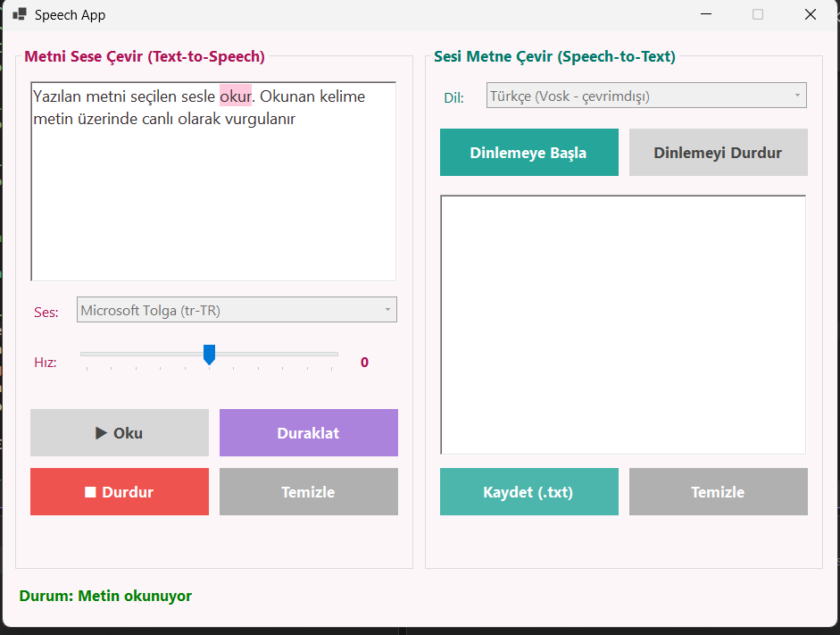
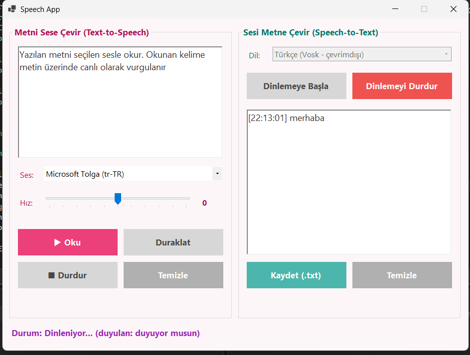

# YMH219 - Speech App

Nesne Tabanlı Programlama (YMH219) dersi kapsamında geliştirilmiş, ses ile metin arasında çift yönlü dönüşüm yapan bir Windows Forms uygulamasıdır.

- **Text-to-Speech:** Yazılan metni seçilen sesle okur. Okunan kelime metin üzerinde canlı olarak vurgulanır.
- **Speech-to-Text:** Mikrofondan alınan **Türkçe** konuşmayı internet bağlantısı olmadan metne dönüştürür.

## Kullanılan Teknolojiler

| Teknoloji | Kullanım amacı |
|---|---|
| C# / .NET 10, Windows Forms | Uygulama ve arayüz |
| `System.Speech` (NuGet) | Metni sese çevirme (Windows konuşma motoru) |
| `Vosk` (NuGet) | Çevrimdışı konuşma tanıma |
| `NAudio` (NuGet) | Mikrofondan ses kaydı |
| `vosk-model-small-tr-0.3` | Türkçe konuşma tanıma modeli (Apache 2.0, [alphacephei.com/vosk](https://alphacephei.com/vosk/models)) |

## Kurulum ve Çalıştırma

1. Depoyu klonlayın:
   ```bash
   git clone https://github.com/Sumeyraadiyaman/YMH219-SpeechApp.git
   ```
2. `YMH219-SpeechApp.slnx` dosyasını Visual Studio ile açın. NuGet paketleri otomatik olarak geri yüklenir.
3. `F5` tuşu ile uygulamayı çalıştırın.

> Türkçe konuşma modeli depoda `Models/vosk-model-small-tr-0.3` klasöründe yer alır ve derleme sırasında otomatik olarak çıktı klasörüne kopyalanır. Model eksikse [buradan](https://alphacephei.com/vosk/models/vosk-model-small-tr-0.3.zip) indirilip bu klasöre çıkarılmalıdır.

## Özellikler

### Metni Sese Çevir (Text-to-Speech)
- **Oku / Duraklat / Devam Et / Durdur / Temizle** işlevleri
- **Ses seçimi (ek özellik):** Bilgisayarda yüklü sesler listelenir; Türkçe ses varsa otomatik seçilir.
- **Hız ayarı (ek özellik):** -10 ile +10 arasında okuma hızı
- **Kelime vurgulama:** Okunan kelime metin üzerinde pembe ile işaretlenir.
- Okuma sırasında metin kutusu kilitlenir; boş metin için uyarı verilir.

### Sesi Metne Çevir (Speech-to-Text)
- **Dinlemeye Başla / Dinlemeyi Durdur** işlevleri
- **Canlı tahmin:** Konuşurken tanınan kelimeler durum çubuğunda anlık olarak görünür.
- **Zaman damgası (ek özellik):** Her tanınan cümle saatiyle birlikte listelenir.
- **Kaydet (.txt) (ek özellik):** Tanınan metin dosyaya kaydedilebilir.
- **Çevrimdışı çalışma:** İnternet bağlantısı gerektirmez.

### Genel
- **Durum göstergesi:** Hangi işlemin aktif olduğu renkli olarak gösterilir (okunuyor, duraklatıldı, dinleniyor, model yükleniyor).
- **Hata yönetimi:** Mikrofon, hoparlör, model veya dosya hatalarında uygulama kapanmaz; kullanıcıya anlaşılır mesaj gösterilir.
- **Kaynak yönetimi:** Konuşma motoru, mikrofon ve model, kullanım sonrasında ve pencere kapanırken serbest bırakılır.

## Teknik Notlar

- Türkçe model birkaç saniyede yüklendiği için `async/await` ile arka planda yüklenir; arayüz donmaz.
- Mikrofon verisi arka plan iş parçacığında işlendiğinden, arayüz güncellemeleri `BeginInvoke` ile arayüz iş parçacığına aktarılır; tanıyıcıya eşzamanlı erişim `lock` ile korunur.
- Vosk sonuçları JSON biçiminde döndürür; `System.Text.Json` ile ayrıştırılır.

## Ekran Görüntüleri

**Metni sese çevirme (okunan kelime vurgulanıyor)**



**Sesi metne çevirme**



## Bilinen Sınırlamalar / Geliştirme Notları

- Kullanılan Türkçe Vosk modeli küçük (35 MB) bir modeldir; tanıma doğruluğu sınırlıdır. Net, akıcı konuşma ve sessiz ortam sonuçları iyileştirir.
- Windows'un yerleşik konuşma tanıma motoru (`System.Speech.Recognition`) Türkçeyi desteklemediği için konuşma tanımada Vosk tercih edilmiştir.
- Türkçe okuma için Windows'ta Türkçe ses (ör. *Microsoft Tolga*) yüklü olmalıdır; yoksa yüklü olan diğer sesler kullanılır.
- Okuma ve dinleme aynı anda yapılırsa mikrofon hoparlörden gelen sesi de algılayabilir.
- Geliştirme fikri: Daha yüksek doğruluk için Whisper tabanlı bir tanıma motoru eklemek.

## Öğrenci

- **Ad Soyad:** Sümeyra Adıyaman
- **Öğrenci No:** 250541012